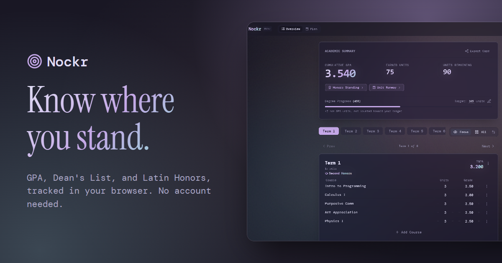
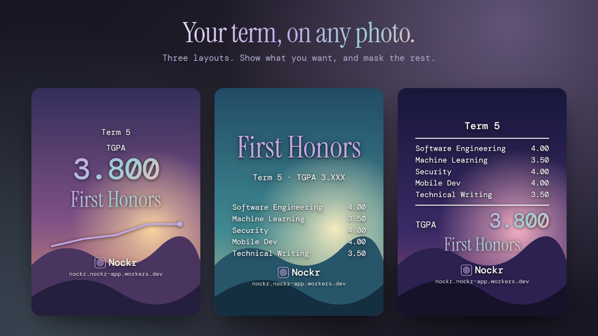

# Nockr

A GPA tracker for university students. No account, no backend, no data leaves your browser.

**Try it:** [nockr.nockr-app.workers.dev](https://nockr.nockr-app.workers.dev)



> **Disclaimer:** Nockr is an independent student project and is not affiliated with, endorsed by, or connected to De La Salle University, the University of the Philippines, the University of Santo Tomas, Ateneo de Manila University, or any other academic institution. University presets are community-sourced approximations — always verify your institution's official policies.

---

## Table of Contents

- [Features](#features)
- [Getting Started](#getting-started)
- [Tech Stack](#tech-stack)
- [Project Structure](#project-structure)
- [Promo Images](#promo-images)
- [Data & Privacy](#data--privacy)
- [Contributing](#contributing)
    - [Commit Convention](#commit-convention)
    - [Branching Convention](#branching-convention)
- [License](#license)

---

## Features

### Core Tracking
- Term-based grade entry with live TGPA and CGPA
- Degree progress bar against a configurable total unit count
- Focus view (one term at a time) and Grid view (all terms)
- Keyboard inputs on term cards — `Enter` flows through fields, `↑↓` steps grades, `Escape` clears

### Honors
- Dean's List badge per term with configurable tiers, unit minimums, and course grade floors
- Latin Honors modal with projected standing based on current CGPA
- No-fail policy flag — alerts when any course grade would disqualify Latin Honors eligibility

### University Settings
Ships with presets for four Philippine universities and a fully custom mode:

| Preset | Scale | Direction | Failing Grade |
|---|---|---|---|
| **DLSU** | 0.0 – 4.0 | Ascending | 0.0 |
| **UP** | 1.0 – 5.0 | Descending | 5.0 |
| **UST** | 1.0 – 5.0 | Descending | 5.0 |
| **ADMU** | 0.0 – 4.0 | Ascending | 0.0 |
| **Custom** | Configurable | Configurable | Configurable |

Custom mode exposes full control over grade bounds, direction, step size, honor tier labels and thresholds, unit constraints, and honor policies.

### Plan Page
A separate full-screen flowchart view of all terms. Courses can be dragged between terms — the move carries the full course object (name, units, grade). Terms can be reordered by dragging their handle or from the Reorder Terms list, and `Term N` names renumber to match while renamed terms keep their names. Changes sync back to the main tracker immediately.

### Course Checklist
A collapsible panel on the Plan page listing the courses in your curriculum. Drag a course onto a term to plan it, or move it there if it is already placed. Items check off on their own from your grades, and manual checks cover anything taken elsewhere. Ships with a DLSU GE preset; other universities start empty. Courses can be added one at a time, pasted as a list, or filled in by an ArchersHub import.

### Unit Calculator
Answers the question: given your current CGPA and remaining units, how many units of a given grade can you still afford before dropping below your target Latin Honor? Calculates for every grade step defined in your university settings, including the failing grade where applicable.

### Theme System
21 built-in themes (dark and light variants), including school-color themes that are inspired by, and not affiliated with, the universities they reference, plus a custom 15-token palette editor. Themes apply before the first paint — no flash of unstyled content. Custom themes can be exported as a `.css` file and imported back.

### Export Page
Turn a term or your cumulative standing into a sticker to share. Stickers are transparent PNGs, so they sit on top of any photo, or a photo can be added right on the page.

- **Three layouts:** Stat stack, Honors, and Scorecard, each remembering what it shows
- **Privacy:** GPA and course grades can be shown, masked (`3.XXX`), or hidden, down to a single course
- **No honors this term:** leave the line off or pick a kind message. The sticker never says you missed out
- **Style:** text color, thickness, shadow, alignment, an accent or gradient highlight, and a theme of its own
- **Formats:** tight sticker crop, 9:16, 3:4, or 1:1
- **Photo background:** zoom, position, brightness, contrast, and saturation. Photos stay on your device
- **Preview:** full screen with pinch and wheel zoom



---

## Getting Started

**Prerequisites:** [Bun](https://bun.sh)

```bash
git clone https://github.com/pring-nt/nockr.git
cd nockr
bun install
bun run dev
```

Open [http://localhost:5173](http://localhost:5173).

```bash
bun run build       # Production build
bun run preview     # Preview production build
bun run check       # svelte-check + TypeScript
bun run lint        # Prettier, ESLint, and knip
bun run format      # Prettier
```

---

## Tech Stack

| Layer | Choice |
|---|---|
| Framework | SvelteKit + Svelte 5 Runes |
| Language | TypeScript |
| Styling | Tailwind CSS v4 |
| UI Components | shadcn-svelte |
| Validation | Zod |
| Icons | Lucide Svelte |
| Drag and Drop | svelte-dnd-action |
| Image Export | html-to-image |
| Animation | anime.js |
| Storage | localStorage |
| Package Manager | Bun |

---

## Project Structure

```
src/
├── lib/
│   ├── components/
│   │   ├── honors/         # Latin Honors modal
│   │   ├── layout/         # Header shell
│   │   ├── plan/           # TermColumn, CourseCard, ChecklistPanel (Plan page)
│   │   ├── settings/       # University form, theme gallery, data tools
│   │   ├── share/          # Sticker canvas, layouts, export page panels
│   │   ├── summary/        # Academic summary card & unit calculator
│   │   ├── term/           # TermCard, CourseRow, TermNavigator
│   │   └── ui/             # shadcn-svelte primitives
│   ├── logic/
│   │   ├── gpa.ts          # TGPA, CGPA, units earned
│   │   ├── honors.ts       # Tier matching, Dean's List, Latin Honors
│   │   ├── share.ts        # Sticker data, canvas capture, grade masking, photo loading
│   │   └── unitCalc.ts     # Unit calculator solver
│   ├── schemas/            # Zod schemas for all data types
│   ├── stores/             # localStorage-backed Svelte stores
│   ├── themes/             # Theme metadata + CSS variable applicator
│   ├── motion.ts           # anime.js helpers, gated for reduced motion
│   └── constants.ts        # University presets, default checklist, export canvas sizes
└── routes/
    ├── +layout.svelte      # Aurora background, GPU detection
    ├── +page.svelte        # Main tracker (summary + term navigator)
    ├── plan/
    │   └── +page.svelte    # Plan page (flowchart + course checklist)
    ├── export/
    │   └── +page.svelte    # Export page (sticker layouts, per-value privacy, formats)
    ├── settings/
    │   └── +page.svelte    # Settings page (themes, university rules, data and backup)
    └── layout.css          # Theme variables, glass/aurora utilities, .no-gpu fallbacks
```

---

## Promo Images

Marketing images live in [`docs/promo`](docs/promo), and the social sharing card is `static/og-image.png`. Every grade and course in them is sample data.

| File | Size | Good for |
|---|---|---|
| `overview-square.png` | 1080 × 1080 | Instagram and Facebook posts |
| `story.png` | 1080 × 1920 | Instagram and Facebook stories |
| `stickers-wide.png` | 1600 × 900 | Feature posts and link banners |
| `phones-wide.png` | 1600 × 900 | Feature posts and link banners |
| `tour-wide.png` | 1600 × 900 | One image covering every page |
| `overview-wide.png` | 1600 × 900 | Overview page |
| `honors-wide.png` | 1600 × 900 | Honors Standing and Unit Runway |
| `plan-wide.png` | 1600 × 900 | Plan page |
| `export-wide.png` | 1600 × 900 | Export page |
| `themes-wide.png` | 1600 × 900 | Themes in Settings |
| `university-wide.png` | 1600 × 900 | University rules in Settings |

---

## Data & Privacy

Nockr uses no database and has no backend. All data is stored locally in your browser's `localStorage` under the keys `nockr_state`, `nockr_theme`, and `nockr_share`. Nothing is transmitted anywhere, and a photo added to the Export page stays in memory and is never saved.

Clearing your browser's site data or using private/incognito mode will reset the app. To keep a copy, use Backup in the Data section of Settings. The JSON file holds your grades, theme, and export settings, and Restore brings them back.

---

## Contributing

Contributions are welcome. Please follow the conventions below for a consistent history.

### Commit Convention

Format: `<type>(<scope>): <subject>`

The scope is optional but encouraged for larger codebases.

```
feat(plan): add drag-and-drop course reordering
fix(scroll): correct sub-pixel edge snap in TermNavigator
chore: update dependencies
```

#### Types

| Type | When to use |
|---|---|
| `feat` | New feature or user-facing addition |
| `fix` | Bug fix |
| `refactor` | Code change with no behavior difference |
| `style` | Formatting, whitespace, visual-only changes |
| `chore` | Tooling, dependencies, config, non-src changes |
| `docs` | README or documentation only |
| `perf` | Performance improvement |
| `test` | Adding or updating tests |

#### Rules
- Use the imperative mood in the subject: "add X", not "added X" or "adds X"
- Keep the subject line under 72 characters
- No period at the end of the subject line
- If a commit needs more context, add a body after a blank line

### Branching Convention

Format: `<type>/<short-description>`

```
feat/unit-calculator
fix/scroll-edge-snap
refactor/share-canvas-theme-injection
```

#### Branch Types

| Type | When to use |
|---|---|
| `feat` | New feature work |
| `fix` | Bug fix |
| `refactor` | Restructuring existing code |
| `chore` | Tooling, config, dependency updates |
| `docs` | Documentation only |

#### Rules
- Use kebab-case for the description
- Keep it short — 2 to 4 words is enough
- Branch off `main` for all work
- Delete branches after merging

---

## License

GPL 3.0